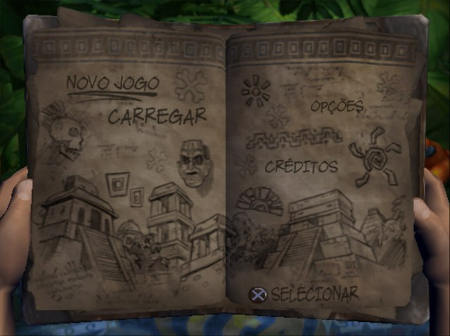
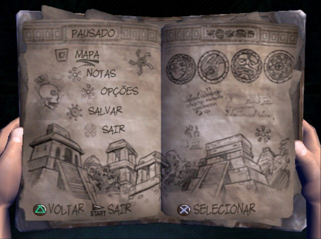
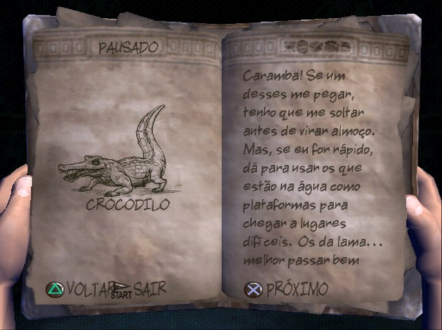
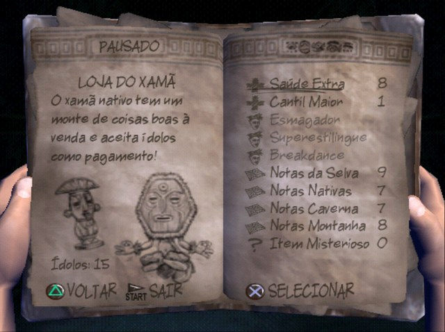
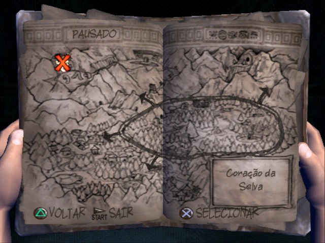
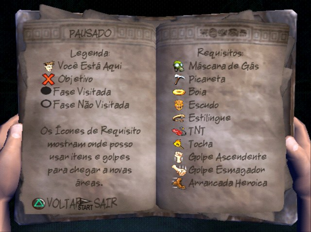

# Pitfall: The Lost Expedition (PS2) — Tradução PT-BR

Tradução de fãs de **Pitfall: The Lost Expedition** (PlayStation 2, versão americana **SLUS-20408**) para o português do Brasil, por **Oblytoid**.

### ⬇️ [Baixar a versão mais recente (v0.9.1 beta)](https://github.com/Oblytoid/Pitfall-Lost-Expedition-PTBR/releases)

| | |
|:---:|:---:|
|  |  |
| Menu principal | Menu de pausa |
|  |  |
| Bestiário | Loja do Xamã |
|  |  |
| Mapa | Legenda e requisitos |

## O que está traduzido
- Menus, opções e telas de memory card
- Diário do Harry, bestiário e Manual do Herói
- Loja do Xamã, dicas e tutoriais
- Nomes de fases e cargos dos créditos
- Acentuação completa (á é í ó ú â ê ô ã õ ç à)

As cutscenes continuam com o áudio original em inglês, porque o jogo não tem legendas nelas.

**Status:** beta. Todo o texto está traduzido e revisado, e o jogo foi testado no PCSX2. A segunda metade ainda não foi conferida tela a tela, então avisos de erro são muito bem-vindos.

## Como jogar
1. Baixe o `.zip` da versão mais recente em **[Releases](https://github.com/Oblytoid/Pitfall-Lost-Expedition-PTBR/releases)** e descompacte numa pasta.
2. Arraste a ISO original do jogo para cima de **`ARRASTE A ISO AQUI.bat`**.
3. Espere o **"Pronto!"**. A ISO traduzida, `Pitfall - The Lost Expedition (PT-BR).iso`, aparece na mesma pasta da original, e a original não é alterada.
4. Abra a ISO traduzida no PCSX2 ou use no PS2 pelo OPL.

O `LEIAME.txt` do pacote também explica como aplicar com o Delta Patcher ou com o xdelta3 no Linux/macOS.

### ISO compatível
O patch funciona só com a ISO **limpa** da versão americana:

| | |
|---|---|
| Código | SLUS-20408 (NTSC-U) |
| Tamanho | 1.342.144.512 bytes |
| CRC32 | `9CBE62BE` |
| MD5 | `2bb11628acbf208751c6a3cb5f69e7e9` |
| SHA-1 | `d13c1b38f7cda483248656e69a31c756dd82c082` |

O nome do arquivo não importa. Este repositório **não contém o jogo** e não indica onde baixá-lo: faça a ISO a partir do seu próprio disco. Num PC com leitor de DVD, isso pode ser feito com o ImgBurn em "Create image file from disc".

### Deu "ATENÇÃO: esta ISO não é a versão esperada"?
A sua cópia é diferente da original americana. Pode ser de outra região (PAL/Europa), estar em outro formato (CSO, CHD, ZSO, BIN/CUE) ou ter sido modificada. Converta para `.iso` ou faça a cópia direto do disco e compare com os códigos acima.

### Perguntas frequentes
- **Funciona no PS2 de verdade?** Deve funcionar pelo OPL, mas ainda não foi testado em console real. Se testar, conta pra gente.
- **Meus saves continuam valendo?** Sim, saves da versão original funcionam na traduzida.
- **Usei a v0.9 beta e não funcionou.** Ela foi retirada porque recusava a ISO limpa. Use a v0.9.1 beta ou mais nova.

## Encontrou um problema?
Abra uma [Issue](https://github.com/Oblytoid/Pitfall-Lost-Expedition-PTBR/issues) com um print da tela e a parte do jogo em que estava. O histórico de versões está no [CHANGELOG](CHANGELOG.md).

## Ferramentas (para quem quer estudar ou contribuir)
Scripts em Python 3.8 ou mais novo (testado no 3.12), só com a biblioteca padrão. Não precisa instalar nada além do Python. Detalhes de cada script em [`ferramentas/LEIAME.md`](ferramentas/LEIAME.md).

### Estrutura de pastas esperada
```
Pitfall/
├─ ferramentas/   scripts (neste repositório)
├─ script/        textos traduzidos (.txt), fora do repositório público
├─ ISOs/          Pitfall - The Lost Expedition (USA).iso  ← cópia da sua ISO original
├─ extraido/      Pitfall - The Lost Expedition (PT-BR)/data/...  ← conteúdo da ISO
├─ build/         gerado: arquivos novos e a ISO de teste
└─ patch/         gerado: .xdelta e o pacote .zip
```
As pastas `ISOs/`, `extraido/`, `build/` e `patch/` ficam fora do Git (ver `.gitignore`).

### Como gerar
1. Copie a ISO original para `ISOs/` com o nome acima e extraia o conteúdo dela (por exemplo, com o 7-Zip) para `extraido/Pitfall - The Lost Expedition (PT-BR)/`. A ISO precisa ser a limpa (códigos no `LEIAME.txt` do pacote).
2. `ferramentas/extrair.py` gera os textos editáveis.
3. `ferramentas/gerar_iso.bat` insere os textos e monta `build/Pitfall_PTBR_teste.iso`.
4. `ferramentas/gerar_patch.bat` cria o `.xdelta` e o pacote `.zip`. Precisa do [xdelta3](https://github.com/jmacd/xdelta-gpl/releases) na pasta `ferramentas`.

### Formato dos arquivos do jogo
A documentação técnica está nos comentários de `quickdat.py`, `datasets.py` e `creditos.py`: estrutura do `quickdat.arc`, as cópias (algumas compactadas) dentro do `datasets.arc`, o índice `index.ind` e a lista de relocação de ponteiros.

## Créditos
- Tradução, coordenação e testes: **Oblytoid**
- Ferramentas e apoio na tradução: Claude (Anthropic)
- Revisão e pesquisa: Gemini (Google)

## Licença
As ferramentas usam a licença MIT (arquivo [`LICENSE`](LICENSE)). Ela vale só para o código deste repositório, não para o jogo.

*Pitfall* é marca da Activision Publishing, Inc. Projeto de fãs, sem fins lucrativos e sem ligação com a Activision ou a Edge of Reality.
